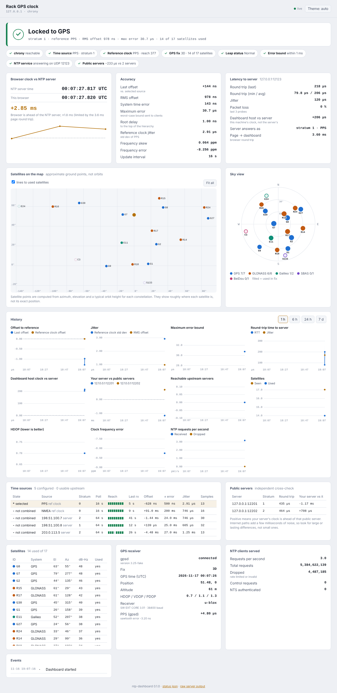

# NTP Dashboard

A self-hosted, one-page web dashboard for **any NTP server**: a GPS/PPS-disciplined chrony box, a Proxmox host syncing to a pool, a pfSense or OPNsense firewall, or a plain Linux server running chrony or ntpd.

It answers the questions that matter: *Is my time server healthy? How accurate is it? Is it agreeing with the rest of the internet? Is my own computer's clock right?*



<sub>Screenshot with demo data. A GPS/PPS server shows the satellite map and sky view; servers without GPS simply don't get those panels. [Network-only view](docs/screenshot-network.png).</sub>

## Features

- **Plain-language status**: "Locked to GPS", "Synchronised to network time", "Not synchronised", with a row of pass/warn/fail checks that explain why.
- **Works with what you have**: chrony (full detail), ntpd (full detail through the NTP control protocol), or any NTP server (basic view from the NTP port alone).
- **Accuracy**: offset, RMS offset, jitter, maximum error bound, root delay, frequency error and skew.
- **Latency** to the server: round trip, jitter and packet loss from real NTP queries.
- **Browser clock vs NTP server**: see how far your own device is off, with the uncertainty of the measurement.
- **Public server cross-check**: compares your server against independent servers (Cloudflare and Google by default, configurable) to catch a server that is confidently wrong.
- **Upstream health**: counts reachable upstream servers and warns when you have too few to detect a bad one.
- **GPS panels (optional)**: satellite map, sky plot, signal strength, fix quality, HDOP and PPS offset, shown only when gpsd is available.
- **History** from 1 hour to 7 days, a time-source table, NTP request rate (chrony, local only) and an event log.
- **Small and private**: one container, Python standard library only, no database server, no telemetry. Data stays in a local SQLite file.

## What you get with each kind of server

| Your server | What the dashboard reads | Detail |
|---|---|---|
| **chrony** (Linux, Proxmox, Raspberry Pi) | `chronyc` over the network | Full |
| **ntpd** (pfSense, OPNsense, older Linux) | NTP control protocol (mode 6) | Full, needs a one-line ACL change |
| **Anything else** (router, appliance, public pool) | A normal NTP query | Basic: stratum, reference, latency, offset to this host, error bound |
| **GPS receiver on gpsd** (any of the above) | gpsd JSON on TCP 2947 | Adds satellites, fix and PPS |

The mode is detected automatically (`SERVER_TYPE=auto`). If detection can't read the daemon, the dashboard falls back to the basic view and tells you how to unlock more.

## Quick start

### Option A: ready-made image (no build)

Create a folder with two files.

`docker-compose.yml`:

```yaml
services:
  ntp-dashboard:
    image: atomizeee/ntp-dashboard:latest   # or ghcr.io/<you>/ntp-dashboard:latest
    container_name: ntp-dashboard
    restart: unless-stopped
    init: true
    env_file: .env
    ports:
      - "8080:8080"
    volumes:
      - ntp-dashboard-data:/data
    read_only: true
    tmpfs:
      - /tmp
    cap_drop:
      - ALL
    security_opt:
      - no-new-privileges:true

volumes:
  ntp-dashboard-data:
```

`.env` (only `SERVER_HOST` is required; the full list is in [`.env.example`](.env.example)):

```env
SERVER_NAME=Home NTP server
SERVER_HOST=192.168.1.10
```

Then start it and open `http://<docker-host>:8080`:

```bash
docker compose up -d
```

Running on the same machine as the NTP server? Replace the `ports:` block with `network_mode: host`, set `SERVER_HOST=127.0.0.1`, and add `PORT=8080` to `.env`.

### Option B: build from source

You need Docker with the Compose plugin on any machine that can reach the NTP server.

```bash
git clone https://github.com/<you>/ntp-dashboard.git
cd ntp-dashboard
cp .env.example .env          # set SERVER_HOST to your NTP server's IP or name
docker compose up -d --build
docker compose run --rm ntp-dashboard python -m app.selftest   # optional: checks every connection
```

Open `http://<docker-host>:8080`.

If the dashboard runs **on the same machine as the NTP server** (for example directly on the Proxmox host), use host networking so `127.0.0.1` works:

```bash
docker compose -f docker-compose.host.yml up -d --build
```

Just want to look around? `python3 -m tests.demo network` serves fake data on port 8080. Other scenarios: `gps`, `ntpd`, `basic`.

## Prepare your server

Pick the guide for your setup. Each takes a few minutes.

| Guide | Covers |
|---|---|
| [chrony (Linux, Proxmox, Raspberry Pi)](docs/chrony.md) | Remote monitoring, firewall |
| [pfSense and OPNsense (ntpd)](docs/pfsense.md) | Allowing status queries |
| [GPS and PPS with gpsd](docs/gps.md) | Listening on the LAN, receiver setup notes |
| [Basic mode and public servers](docs/basic-mode.md) | When you can't change the server |
| [Gitea and GitHub](docs/gitea.md) | CI on a self-hosted Gitea runner, moving to GitHub |

## Configuration

Settings are environment variables, normally set in `.env`. See [`.env.example`](.env.example) for a commented template.

| Variable | Default | Meaning |
|---|---|---|
| `SERVER_HOST` | `127.0.0.1` | The NTP server to monitor (IP or name) |
| `SERVER_TYPE` | `auto` | `auto`, `chrony`, `ntpd` or `probe` (NTP port only) |
| `SERVER_NAME` | `NTP server` | Title shown in the page header |
| `CHRONY_PORT` | `323` | chrony command port (UDP) |
| `NTP_PORT` | `123` | NTP port used for latency, and for ntpd status |
| `POLL_INTERVAL` | `5` | Seconds between server polls |
| `GPSD_ENABLED` | `auto` | `auto` shows GPS panels only when gpsd answers; `true`/`false` force it |
| `GPSD_HOST` / `GPSD_PORT` | `SERVER_HOST` / `2947` | gpsd connection |
| `REFERENCE_SERVERS` | `time.cloudflare.com,time.google.com` | Public servers for the cross-check. Empty turns it off. `host:port` is accepted |
| `REFERENCE_INTERVAL` | `64` | Seconds between public checks (minimum 32) |
| `HOST_PORT` | `8080` | Published port (`docker-compose.yml`) |
| `BASIC_AUTH_USER` / `BASIC_AUTH_PASS` | off | Password-protect the page |
| `COORD_DECIMALS` | `2` | Rounding of the antenna position (2 is about 1 km, 6 is exact) |
| `HIDE_POSITION` | `false` | Never send the position to the browser |
| `HISTORY_DAYS` | `7` | History retention (SQLite in the `/data` volume) |
| `SAMPLE_INTERVAL` | `10` | Seconds between stored history samples |
| `MAP_TILE_URL` | OpenStreetMap | Any XYZ tile URL |

Upgrading from an earlier version? `CHRONY_HOST` and `CHRONY_INTERVAL` still work as aliases for `SERVER_HOST` and `POLL_INTERVAL`.

## How the numbers are produced

- **Accuracy** comes from the server's own daemon (`chronyc tracking`, or `ntpq`-style variables from ntpd). *Maximum error* is root dispersion plus half the root delay, the bound the server announces to its clients.
- **Latency** is a direct NTP query from the dashboard to the server. Round trip is network delay with the server's processing time removed.
- **Browser vs NTP clock**: the page asks the dashboard for the current time (its own clock corrected by the measured offset to your server) and compares it with `Date.now()`, using the round trip of that request. Differences below a few milliseconds are within the shown uncertainty.
- **Public server cross-check**: for each public server the dashboard measures its offset from the dashboard host, then subtracts the same measurement made against your server. Internet paths are asymmetric, so expect a few milliseconds of noise; look for large or lasting differences.
- **Health thresholds** depend on the source. With a local reference clock such as GPS/PPS the error bound is judged against 1 ms (warn) and 50 ms (fail). For network time it is 50 ms and 250 ms. At least three usable upstream servers are recommended so a single bad one can be outvoted.
- **Satellite map**: gpsd reports azimuth and elevation only. Each map point is the ground spot below the satellite, computed from your position and a typical orbit height per constellation. It is a visual aid, not an orbit calculation.
- **History** is collected by the dashboard itself, because remote daemons don't expose their logs.

## Security and privacy

- The page is plain HTTP. If you expose it beyond your LAN, put it behind a reverse proxy with TLS and set `BASIC_AUTH_*`.
- The container runs as an unprivileged user with a read-only filesystem and no capabilities.
- Monitoring access is read-only. Open UDP 323 (chrony) or allow NTP status queries (ntpd) **only to the dashboard host**.
- gpsd has no authentication. Allow TCP 2947 only from the dashboard host.
- The antenna position is rounded by default. Use `HIDE_POSITION=true` for a public instance.
- The page loads Leaflet from unpkg and map tiles from OpenStreetMap in the viewer's browser. Without internet access it still works and falls back to a plain latitude/longitude plot.
- Public servers receive one NTP request per `REFERENCE_INTERVAL` from the dashboard. Keep it at 64 seconds or more, or set `REFERENCE_SERVERS=` to disable.

See [SECURITY.md](SECURITY.md) to report a vulnerability.

## Known limits

- **"NTP clients served" is only available for chrony when the dashboard runs on the same machine.** chrony answers `serverstats` to local programs only (`501 Not authorised` over the network). This does not mean nobody uses your server. ntpd and basic mode don't provide it.
- The ntpd reader has been tested against a simulated server and the NTP specification, not against every ntpd build. If something looks off, open `/api/raw` and attach it to an issue.
- Source names are shown as IP addresses to avoid slow reverse DNS.
- The dashboard monitors one server per instance. Run several instances for several servers.

## Troubleshooting

Run `docker compose run --rm ntp-dashboard python -m app.selftest` first. Open `/api/raw` to see exactly what the server returned.

| Symptom | Likely cause |
|---|---|
| Basic view only, although the server runs chrony | `bindcmdaddress` / `cmdallow` missing, or UDP 323 blocked ([guide](docs/chrony.md)) |
| Basic view only, although the server runs ntpd | `restrict ... noquery` blocks status queries ([guide](docs/pfsense.md)) |
| "NTP service" check fails | UDP 123 blocked, or the server has no `allow` rule for the dashboard host |
| GPS panels missing | gpsd not listening on the LAN, TCP 2947 blocked, or `GPSD_ENABLED=false` ([guide](docs/gps.md)) |
| Public servers show "no answer" | The dashboard host has no outbound UDP 123 |
| Map shows "Access blocked" tiles | The tile server needs a Referer header (sent by default), or set another `MAP_TILE_URL` |
| Everything lags while Docker runs | Docker's address pool overlaps your LAN. Set `default-address-pools` in `/etc/docker/daemon.json` to an unused range such as `10.201.0.0/16` |

## Development

```bash
python3 -m unittest discover -s tests -t . -v
python3 -m tests.demo gps      # fake data: gps, network, ntpd, basic
```

No third-party Python packages are used. The frontend is plain JavaScript with Leaflet for the map. Continuous integration runs the tests and publishes a multi-architecture image to GitHub Container Registry.

## Roadmap

3D globe with real orbits, several servers on one page, NTS statistics, alerts by email or webhook.

## License

[MIT](LICENSE)
